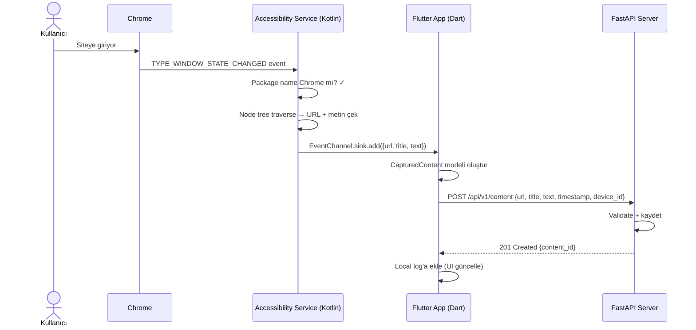

# GiDA — Android Accessibility Service + Flutter + FastAPI
## İmplementasyon Planı (Aşama 1: Content Yakalama & Server'a Gönderme)

---

## Strateji Değişikliği Özeti

| | Eski Plan | Yeni Plan |
|---|---|---|
| Platform | Masaüstü Chrome Extension | Android Flutter Uygulaması |
| Yakalama Yöntemi | Content Script (DOM) | Android Accessibility Service |
| Backend | TBD | Python + FastAPI (local → cloud) |
| Aşama 1 Hedefi | Full filtreleme | Sadece içerik yakalayıp server'a gönder |

---

## Mimari Genel Bakış

```
┌─────────────────────────────────────────────────────┐
│                  Android Telefon                     │
│                                                      │
│  ┌──────────────────────────────────────────────┐   │
│  │             Flutter Uygulaması               │   │
│  │                                              │   │
│  │  ┌─────────────┐      ┌──────────────────┐  │   │
│  │  │   Dart UI   │      │  HTTP Client     │  │   │
│  │  │  (Ayarlar,  │      │  (dio paketi)    │  │   │
│  │  │   Durum,    │      │  POST → Server   │  │   │
│  │  │   Loglar)   │      └────────┬─────────┘  │   │
│  │  └─────────────┘               │             │   │
│  │         ▲                      ▲             │   │
│  │         │    EventChannel      │             │   │
│  │         │   (Platform Channel) │             │   │
│  │         │                      │             │   │
│  │  ┌──────┴──────────────────────┴──────────┐  │   │
│  │  │     Native Android Katmanı (Kotlin)    │  │   │
│  │  │                                        │  │   │
│  │  │   GiDA Accessibility Service           │  │   │
│  │  │   ├── Browser açık mı? (pkg filter)   │  │   │
│  │  │   ├── URL değişti mi?                 │  │   │
│  │  │   ├── Node tree traverse → metin çek  │  │   │
│  │  │   └── EventChannel'a gönder           │  │   │
│  │  └────────────────────────────────────────┘  │   │
│  └──────────────────────────────────────────────┘   │
│                                                      │
│  Chrome / Firefox / Samsung Browser (izleniyor)     │
└─────────────────────────────────────────────────────┘
                         │
                    HTTP (POST)
                         │
┌────────────────────────▼────────────────────────────┐
│              Python FastAPI Server                   │
│                                                      │
│  POST /api/v1/content  →  Kaydet + Log'a yaz        │
│  GET  /api/v1/logs     →  Gelen içerikleri listele  │
└─────────────────────────────────────────────────────┘
```

---

## Accessibility Service Nasıl Çalışır?

### Yakalayabildiğimiz Olaylar

```
AccessibilityEvent Türleri:
│
├── TYPE_WINDOW_STATE_CHANGED    → Kullanıcı yeni sekmeye/siteye geçti
├── TYPE_WINDOW_CONTENT_CHANGED  → Sayfa içeriği güncellendi
└── TYPE_VIEW_TEXT_CHANGED       → URL barına bir şey yazıldı
```

### Browser Package İsimleri (Filtre)

```kotlin
val BROWSER_PACKAGES = setOf(
    "com.android.chrome",           // Google Chrome
    "org.mozilla.firefox",          // Firefox
    "com.sec.android.app.sbrowser", // Samsung Browser
    "com.opera.browser",            // Opera
    "com.microsoft.emmx",           // Edge
    "com.brave.browser"             // Brave
)
```

### Accessibility Node Tree'den Ne Çekebiliriz?

Chrome sayfasında accessibility tree şöyle görünür:
```
Window (Chrome)
├── ToolBar
│   └── EditText [URL barı] ← URL buradan gelir
├── WebView
│   └── [Sayfa içeriği - metin node'ları] ← Metin buradan
└── StatusBar
```

**Çekebildiklerimiz:**
- ✅ URL (address bar EditText node'u)
- ✅ Sayfa başlığı (window title)
- ✅ Ekranda görünen metin node'ları
- ❌ Tam HTML/DOM (buna erişim yok)
- ❌ Resimler (binary data accessibility'den gelmiyor)

---

## Proje Dosya Yapısı

```
gida_app/
│
├── lib/                              ← Flutter (Dart) kodu
│   ├── main.dart
│   ├── services/
│   │   ├── accessibility_service.dart  ← Platform channel wrapper
│   │   └── content_sender.dart         ← HTTP ile server'a gönderme
│   ├── models/
│   │   └── captured_content.dart       ← Veri modeli
│   └── ui/
│       ├── home_screen.dart
│       └── log_screen.dart
│
├── android/
│   └── app/src/main/
│       ├── kotlin/com/gida/app/
│       │   ├── MainActivity.kt
│       │   └── GidaAccessibilityService.kt  ← Ana iş burada
│       ├── res/xml/
│       │   └── accessibility_service_config.xml
│       └── AndroidManifest.xml              ← Servis kaydı
│
└── server/                           ← Python FastAPI
    ├── main.py
    ├── models.py
    ├── database.py
    └── requirements.txt
```

---

## Veri Akışı — Sequence Diagram



---

## API Sözleşmesi

### POST /api/v1/content

**İstek:**
```json
{
  "device_id": "android-uuid-xxxx",
  "url": "https://example.com/page",
  "page_title": "Sayfa Başlığı",
  "visible_text": "Ekranda görünen metin içeriği...",
  "browser_package": "com.android.chrome",
  "timestamp": "2026-07-28T20:00:00Z",
  "event_type": "PAGE_VISIT"
}
```

**Başarılı Yanıt (201):**
```json
{
  "content_id": "cnt_abc123",
  "status": "received",
  "timestamp": "2026-07-28T20:00:00Z"
}
```

### GET /api/v1/logs?device_id=xxx&limit=50

**Yanıt:**
```json
{
  "total": 150,
  "items": [
    {
      "content_id": "cnt_abc123",
      "url": "https://example.com",
      "page_title": "Başlık",
      "timestamp": "2026-07-28T20:00:00Z",
      "browser_package": "com.android.chrome"
    }
  ]
}
```

---

## Aşamalı Geliştirme Planı

### ✅ Aşama 1 — Şu An (Bu Plan)
- Android Accessibility Service yaz (Kotlin)
- Flutter + Platform Channel bağlantısı kur
- FastAPI server kur (local)
- URL + başlık + görünür metin → server'a gönder
- Server'da basit SQLite DB ile kayıt

### 🔜 Aşama 2 — AI Entegrasyonu
- Server'a AI analiz endpoint'i ekle
- Gelen içeriği Gemini/OpenAI API'ye gönder
- Kategori + aksiyon döndür

### 🔜 Aşama 3 — Filtreleme
- Flutter'da aksiyon uygulama (bildirim göster, engel overlay)
- Veli paneline log iletimi

### 🔜 Aşama 4 — Cloud
- Local server → Cloud'a taşı (proje ekibiyle koordine)

---

## Teknik Notlar & Riskler

| Konu | Not |
|---|---|
| **Android izni** | `BIND_ACCESSIBILITY_SERVICE` izni gerekiyor. Kullanıcının ayarlardan manuel aktif etmesi lazım. |
| **Chrome kısıtlamaları** | Chrome bazı node'lara erişimi kısıtlıyor. URL genellikle alınabiliyor ama sayfa içeriği kısmi gelebilir. |
| **iOS** | Accessibility Service yaklaşımı **sadece Android'de** çalışır. iOS'ta bu API yok. |
| **Performans** | Node tree traverse ağır olabilir. Debounce (300ms) eklenecek. |
| **Privacy** | Bu uygulama her şeyi okuyabilir. KVKK / kullanıcı rızası kritik. |
